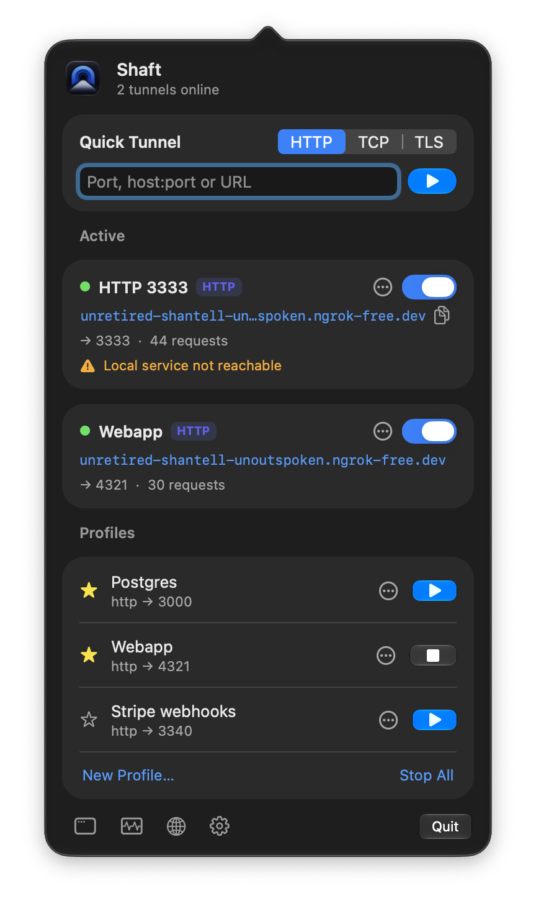

<div align="center">


# Shaft

**A native macOS menu bar client for [ngrok](https://ngrok.com), written in Rust.**

Start tunnels, copy URLs, inspect and replay HTTP traffic and manage your ngrok accounts —<br>
without keeping a terminal open or switching to the dashboard.

[](https://github.com/nnevskij/shaft/actions/workflows/ci.yml)
[](https://github.com/nnevskij/shaft/releases/latest)
[](#license)
[](#requirements)
[](https://www.rust-lang.org)
[](#built-with-vibe-coding)

[Install](#installation) · [Features](#features) · [Build from source](#building-from-source) · [Contributing](#contributing) · [Roadmap](#roadmap)

</div>

<p align="center">
  
</p>

> [!NOTE]
> Shaft is an **unofficial** client and is not affiliated with or endorsed by ngrok Inc. ngrok is a trademark of ngrok Inc.

## Why Shaft?

The ngrok CLI is great, but day-to-day it means a terminal tab per tunnel, copying URLs out of the console and opening the dashboard to look at requests or reserved domains. Shaft puts all of that one click away in the menu bar:

- **No ngrok binary needed** — tunnels run in-process through the official [ngrok-rust SDK](https://github.com/ngrok/ngrok-rust); account resources use the [ngrok API](https://ngrok.com/docs/api/).
- **Truly native** — AppKit UI written in Rust via [`objc2`](https://github.com/madsmtm/objc2), no Electron, no web view.
- **Private by design** — authtokens and API keys live in the macOS Keychain, never on disk, and there is no telemetry.

## Features

| | |
|---|---|
| 🚇 **Tunnels** | HTTP(S), TCP and TLS endpoints with every option of `ngrok http\|tcp\|tls`: custom domains and reserved addresses, basic auth, OAuth, OIDC, webhook verification, IP restrictions, header rules, host rewrite, compression, circuit breaker, mutual TLS, TLS termination, PROXY protocol, bindings, pooling and Traffic Policy (YAML or JSON). |
| ⚡ **Quick tunnels** | Type a port, pick a protocol, press Enter. The URL is already on your clipboard. |
| ⭐ **Profiles** | Save the tunnels you use often; favourites are pinned in the menu and can have a global shortcut. |
| 🔍 **Inspector** | Live list of HTTP requests per tunnel with headers and bodies (gzip/brotli decoded, JSON pretty-printed, hex for binary), filters, replay, edit-and-replay, copy as `curl`, HAR export. |
| 👥 **Accounts** | Several ngrok accounts side by side, each with its own colour, region, proxy and root CAs. |
| 📄 **ngrok.yml** | Import v2/v3 agent configs, export profiles as v3 (options without a v3 field become Traffic Policy rules). |
| 🗂️ **Resources** | List/create/edit/delete reserved domains, TCP addresses, cloud endpoints, agents (restart/update/stop), authtokens, API keys, SSH keys, IP policies & rules, IP restrictions, TLS certificates, event subscriptions/destinations — plus a generic API explorer for everything else. |
| 🩺 **Diagnostics** | DNS/TCP/TLS checks to the ngrok edge and authtoken/API key validation, with a shareable report. |
| 🔄 **Resilience** | Automatic reconnection after sleep or network changes, upstream reachability probe, notifications on state changes. |
| ⬆️ **Updates** | Checks GitHub Releases at launch and daily and offers new versions from the menu bar (can be turned off). |

## Installation

### Download

1. Grab the latest `Shaft-<version>.dmg` from the [Releases page](https://github.com/nnevskij/shaft/releases/latest).
2. Open it and drag **Shaft** into **Applications**.
3. Launch Shaft — it appears in the menu bar and walks you through adding your first account.

Release builds are universal (Apple Silicon and Intel), signed with a Developer ID and notarized by Apple.

### Homebrew

A Homebrew tap is not published yet. Until then you can install the cask straight from this repository:

```bash
brew install --cask https://raw.githubusercontent.com/nnevskij/shaft/main/packaging/homebrew/shaft.rb
```

### Requirements

- macOS 13 Ventura or later (Apple Silicon or Intel)
- An ngrok account — an [authtoken](https://dashboard.ngrok.com/get-started/your-authtoken) is enough for tunnels; an [API key](https://dashboard.ngrok.com/api) is only needed for the Resources window

## Building from source

You need a recent stable [Rust toolchain](https://rustup.rs) (1.85 or newer) and the Xcode Command Line Tools.

```bash
git clone https://github.com/nnevskij/shaft.git
```

```bash
cd shaft && cargo run -p shaft-app
```

To build a proper `.app` bundle (needed for notifications):

```bash
scripts/bundle.sh
```

```bash
open dist/Shaft.app
```

`UNIVERSAL=1`, `SIGN_IDENTITY="Developer ID Application: …"`, `DMG=1` and `NOTARY_PROFILE=…` produce a signed, notarized universal DMG. Releases are cut with `scripts/release.sh` and published by CI; see [docs/RELEASING.md](docs/RELEASING.md).

### Development switches

| Variable | Effect |
|---|---|
| `SHAFT_CONFIG=/path/config.toml` | Use another config file |
| `SHAFT_NO_KEYCHAIN=1` | Keep secrets in memory only |
| `SHAFT_LOG=debug` | Log level (logs: `~/Library/Logs/dev.shaft.app`) |
| `SHAFT_DEBUG_OPEN=popover,inspector,…` | Open UI at launch |
| `SHAFT_SNAPSHOT_DIR=/tmp/snaps` | Render shown views to PNG (no screen recording needed) |
| `SHAFT_UPDATE_URL=http://…` | Read releases from another feed (GitHub release JSON); also enables update checks outside the bundle |
| `SHAFT_NO_GLASS=1` | Use pre-macOS 26 button styles (also needed for snapshots: they cannot capture glass) |

### Tests

```bash
cargo test --workspace
```

An end-to-end test opens a real tunnel when an authtoken is provided:

```bash
SHAFT_E2E_AUTHTOKEN=… cargo test -p shaft-core --test manager -- --ignored
```

### Project layout

| Crate | Purpose |
|---|---|
| [`shaft-config`](crates/shaft-config) | Data model, `config.toml` persistence, Keychain secrets, validation, `ngrok.yml` import/export |
| [`shaft-inspector`](crates/shaft-inspector) | Capturing HTTP reverse proxy, exchange store, replay, curl/HAR/body formatting |
| [`shaft-api`](crates/shaft-api) | ngrok REST API client and resource catalog |
| [`shaft-core`](crates/shaft-core) | Tunnel manager (sessions per account, reconnection, probes), diagnostics — no UI |
| [`shaft-app`](crates/shaft-app) | AppKit UI via `objc2`: status item, popover, windows, notifications, hotkeys |

The product requirements are in [docs/shaft-prd.md](docs/shaft-prd.md) (in Italian).

## Built with vibe coding

Shaft was built through **vibe coding**: almost all of the code in this repository was written by AI coding agents, not typed by hand.

How it was made:

- **Requirements first.** A human wrote the product requirements ([docs/shaft-prd.md](docs/shaft-prd.md)): what Shaft should do, for whom, and the parity it should reach with the ngrok CLI.
- **AI writes the code.** The implementation — the Rust crates, the AppKit UI, the tests, the CI and release scripts — was generated by AI agents, steered through prompts and iterated feature by feature.
- **A human tests the result.** Every feature was tried by hand in the running app, and the automated test suite runs on every push.

What that means for you:

- The code has **not been reviewed line by line** by a human. It works for the author's daily use, but treat it like any young project: expect rough edges and read the code before relying on it for anything critical.
- Bug reports are especially valuable — please [open an issue](https://github.com/nnevskij/shaft/issues) when something breaks.
- Contributions are welcome whether you write code by hand or with AI help; what matters is that the change is tested.

## Contributing

Contributions of all kinds are welcome: bug reports, feature ideas, docs and code.

- **Bugs** — [open an issue](https://github.com/nnevskij/shaft/issues/new) with your macOS version, Shaft version and steps to reproduce. A report from the **Diagnostics** window and logs from `~/Library/Logs/dev.shaft.app` help a lot (check them for secrets before sharing).
- **Ideas** — open an issue to discuss before starting on larger changes, so effort is not wasted.
- **Pull requests** — keep them focused, and make sure these pass locally:

  ```bash
  cargo fmt --all -- --check
  ```

  ```bash
  cargo clippy --workspace --all-targets -- -D warnings
  ```

  ```bash
  cargo test --workspace
  ```

  For UI changes, please include a screenshot (`SHAFT_SNAPSHOT_DIR` makes this easy).

Unless you explicitly state otherwise, any contribution you submit for inclusion in Shaft is dual-licensed as below, without any additional terms or conditions.

## Roadmap

Planned next, roughly in order:

- [ ] Launch at login and auto-start of selected profiles
- [ ] Companion CLI (`shaft start <profile>`) and a `shaft://` URL scheme
- [ ] Italian localisation
- [ ] Per-tunnel traffic statistics (requests and latency charts)
- [ ] Optional persistence of inspector sessions

Further out:

- [ ] WebSocket frame capture in the inspector
- [ ] macOS widgets and Shortcuts (App Intents) to start profiles
- [ ] Sharing profiles across a team
- [ ] Visual Traffic Policy editor

Not planned: Windows/Linux builds, Mac App Store distribution and telemetry of any kind.

## Acknowledgements

- [ngrok](https://ngrok.com) and the [ngrok-rust SDK](https://github.com/ngrok/ngrok-rust), which do the heavy lifting for tunnels
- [`objc2`](https://github.com/madsmtm/objc2), which makes a native AppKit app in Rust possible
- The Rust ecosystem crates listed in [`Cargo.toml`](Cargo.toml)

## License

Licensed under either of

- Apache License, Version 2.0 ([LICENSE-APACHE](LICENSE-APACHE) or <https://www.apache.org/licenses/LICENSE-2.0>)
- MIT license ([LICENSE-MIT](LICENSE-MIT) or <https://opensource.org/licenses/MIT>)

at your option.
